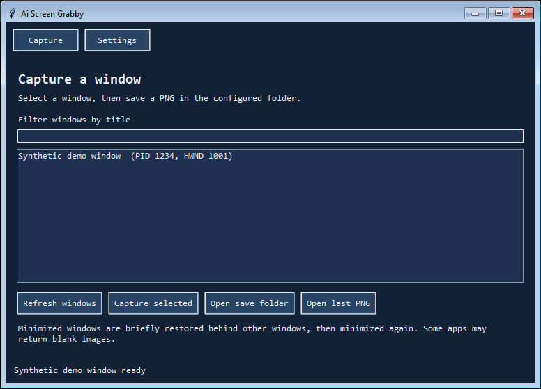
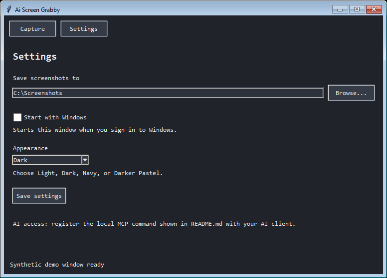
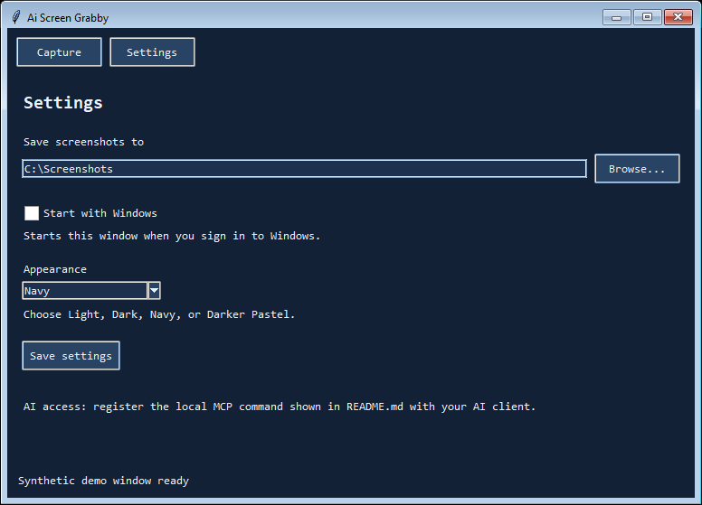
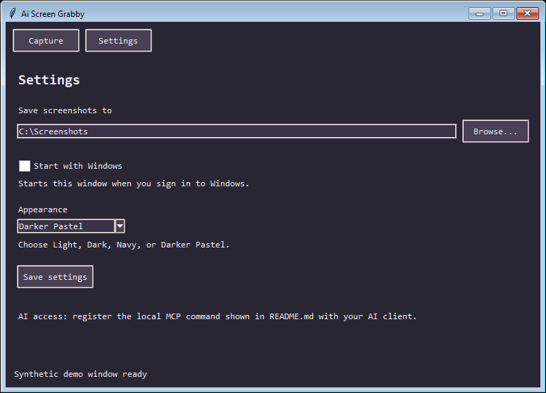

# Ai Screen Grabby

Ai Screen Grabby is experimental Windows software developed for both a human user and an AI assistant. It captures a selected window to a local PNG. The user interface and AI tools share one save directory. **Use at your own risk.** Captures may contain private information; review them before sharing.

The source is open source under the [MIT License](LICENSE).

## Screenshots

These are real Grabby window captures with synthetic window data and a generic save path.



| Dark | Navy | Darker Pastel |
| --- | --- | --- |
|  |  |  |

## How to use it

For the portable download, extract the ZIP and double-click `GrabbyGUI.exe`. It needs Windows 10/11 and an interactive desktop session; Python is not required. To run from source with Python 3.10+, use:

```powershell
python grabby.py
```

You can also double-click **Open Grabby.cmd** in the source folder.

1. Open **Settings** and choose the screenshot directory. Select Light, Dark, Navy, or Darker Pastel; tick **Start with Windows** only if wanted. Choose **Save settings**.
2. On **Capture**, refresh the window list, optionally filter by title, select the target window, and choose **Capture selected**.
3. Choose **Open last PNG** to inspect the result, or **Open save folder** to find it.

Startup uses the current user's Windows Run setting and can be disabled by clearing the checkbox. All interface text uses Consolas, a monospace font. Settings are stored locally in `%APPDATA%\Ai_Screen_Grabby\settings.json`.

## AI access

An AI with local shell access can call `python grabby.py list`, `python grabby.py capture --hwnd HANDLE --pid PID`, `python grabby.py capture-title --title "part of window title"`, and `python grabby.py settings --output-directory "C:\absolute\folder"` directly. For an AI client that calls tools through MCP, register this local stdio server:

```text
Command: python
Arguments: FULL_PATH_TO\grabby.py mcp
```

The MCP client needs a one-time local server configuration. No cloud connector or network service is required by Grabby itself. A client or host may have its own rules for allowing MCP tools. The server provides:

- `list_windows`: window title, handle, PID, dimensions, and minimized state.
- `set_output_directory`: change the same directory shown in Settings. This creates the directory if needed.
- `capture_window`: capture a listed handle and PID. `output_path` is optional; omitting it saves a timestamped PNG in the configured directory. `include_image=true` returns the image through MCP as well as saving it locally; the client may then transmit that image according to its own policy.
- `capture_window_by_title`: capture a unique window from a full or partial title. Matching ignores case. If several windows match, Grabby asks for an exact title, PID, or HWND.

For Codex CLI or its IDE extension, register the portable `Grabby.exe` using `codex mcp add ai_screen_grabby -- "FULL_PATH_TO\Grabby.exe" mcp`, then verify it with `codex mcp get ai_screen_grabby`. Restart the Codex client after registration. The current project directory alone does not register the server.

The PID check prevents a stale or reused handle from silently targeting another process. Explicit output paths must end in `.png`; their parent folder must exist. Existing files are protected unless `overwrite=true`. The MCP capture runs in a child process with a 10-second timeout.

## Covered and minimized windows

Grabby uses Windows `PrintWindow` to ask the target app to render its window, so a window can be captured while another window is in front. To capture a minimized window, Grabby briefly restores it without activating it, captures it, then minimizes it again. The synthetic test confirmed the foreground window stayed unchanged. The target may briefly become visible behind other windows. Windows and the target app do not guarantee a useful image: some apps return blank, stale, or incomplete results, especially GPU-rendered and protected content. Inspect each PNG before treating it as evidence.

The app does not capture the entire desktop or substitute screen pixels from another window. It does not upload captures. Keep private screenshots and test captures out of public packages.

## Verify

```powershell
python -m unittest -v test_grabby.py
python demo_window.py
```

The demo window contains synthetic colors and text for local acceptance checks. `python acceptance_window_states.py` checks covered and minimized captures; `python acceptance_gui.py` checks the GUI; `python acceptance_portable.py` checks the packaged GUI and MCP capture.

## Portable candidate

`Build Portable.ps1` uses the locally installed PyInstaller to build `Grabby.exe` for CLI/MCP and `GrabbyGUI.exe` for the user interface. It places those files, instructions, license notices, and one synthetic UI screenshot in `portable_app`, then creates `Ai-Screen-Grabby-v0.5.0-portable.zip`. The archive contains no user window captures.
